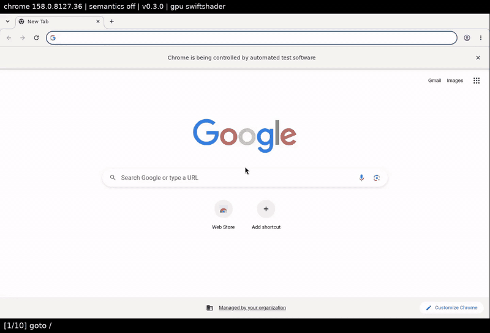

# Content that loads after the first frame cannot be scrolled

If the page fits in the window when it first renders and grows later (data from the network, a `FutureBuilder`, an expanding section), the browser never learns the new height. There is no scrollbar, and the mouse wheel and the `End` key do nothing. Everything below the first screen is unreachable.



[proof.mp4](proof.mp4)

## Steps

1. Run the app:
   ```
   cd app
   flutter run -d chrome --release
   ```
2. Wait about a second until the 60 `Async Item` rows replace `Loading...`.
3. Scroll with the mouse wheel, or press `End`.

Expected: the page scrolls.

Actual: nothing happens. In my run `window.scrollY` stayed at 0, and the document was still as tall as the window (656px) while the content was 3000px tall.

## Cause

`BrowserScroller` updates the placeholder height once after the first frame, and after that only from a [`ScrollController` listener](https://github.com/flutter-zl/flutter-browser-scroll/blob/7193d2085cbb836bec3a3bf5e371e2250a9d5136/lib/src/browser_scroller.dart#L178-L181). That listener runs when the scroll offset changes. When the content grows and the offset stays at 0, Flutter only sends a `ScrollMetricsNotification`, so the placeholder keeps its old height. The browser then has nothing to scroll, so the offset never changes and the listener never runs.

## Possible fix

`_handleNotification` already receives every `ScrollMetricsNotification`, but it [skips the ones from the page's own scrollable](https://github.com/flutter-zl/flutter-browser-scroll/blob/7193d2085cbb836bec3a3bf5e371e2250a9d5136/lib/src/browser_scroller.dart#L281-L288) (depth 0). Calling `_updateHeight()` for those should be enough.
