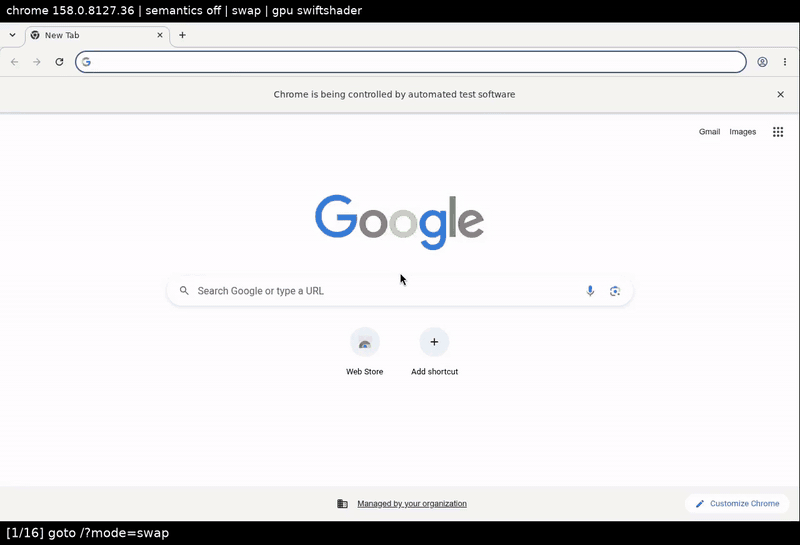
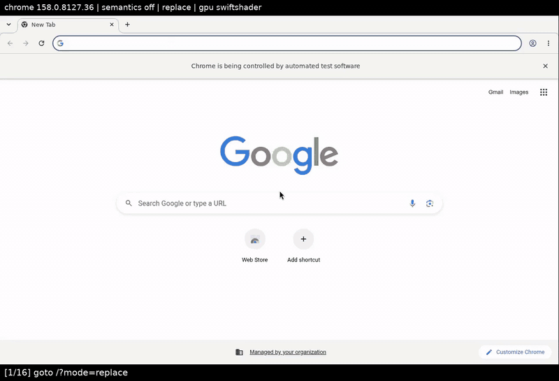

# Replacing a page with another page kills scrolling

When a page that uses `BrowserScroller` is replaced by another page that uses `BrowserScroller`, the new page can't be scrolled. There is no scrollbar and the mouse wheel does nothing until the browser tab is reloaded.

I hit this in two ways: switching the `Scaffold` body between two tabs, and `Navigator.pushReplacement`. I'd expect `GoRouter.go` to do the same since it also replaces the page, but I didn't test it.

Switching tabs:



[proof-tab-switch.mp4](proof-tab-switch.mp4)

`Navigator.pushReplacement`:



[proof-push-replacement.mp4](proof-push-replacement.mp4)

## Steps

1. Run the app:
   ```
   cd app
   flutter run -d web-server --web-port 8080 --release
   ```
2. Open `http://localhost:8080/?mode=swap` in Chrome.
3. Scroll down and back up, to see that the Home tab scrolls.
4. Click `Go to Settings tab`.
5. Scroll with the mouse wheel.

For the `pushReplacement` variant, open `http://localhost:8080/?mode=replace` and click `pushReplacement to second page` in step 4.

Expected: the second page scrolls.

Actual: the second page doesn't scroll. In both runs `window.scrollY` stayed at 0 and the computed style of `<body>` was back to `position: fixed; overflow: hidden; touch-action: none`.

## Cause

Every `BrowserScroller` creates its own `JsViewScroller`. It [saves the `<body>` styles](https://github.com/flutter-zl/flutter-browser-scroll/blob/7193d2085cbb836bec3a3bf5e371e2250a9d5136/lib/src/js_view_scroller.dart#L88-L89) before changing them, and [restores them](https://github.com/flutter-zl/flutter-browser-scroll/blob/7193d2085cbb836bec3a3bf5e371e2250a9d5136/lib/src/js_view_scroller.dart#L355-L358) when it is disposed. Flutter mounts the new page before it disposes the old one, so:

1. The new scroller saves styles that the old scroller already changed.
2. The old scroller restores what it saved, which is [the engine's own `<body>` styles](https://github.com/flutter/flutter/blob/4d19bda07ae859c5d3a205e3a61619ff485a1182/engine/src/flutter/lib/web_ui/lib/src/engine/view_embedder/embedding_strategy/full_page_embedding_strategy.dart#L51-L68).

Nothing applies the package's styles again after that, so the document can't scroll.

## Possible fix

Use one scroller per Flutter view and share it between all the `BrowserScroller`s of that view, so the styles are changed once and restored when the last `BrowserScroller` goes away. That would also be a good place to fix [03](../03-pushed-page-opens-blank).
