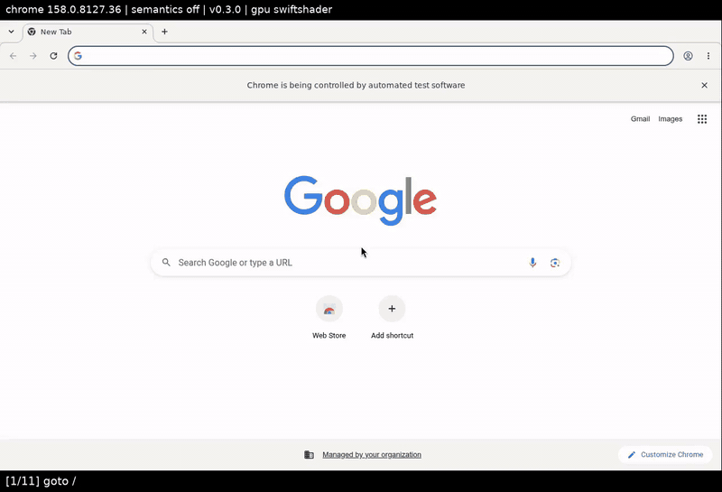

# A page pushed after scrolling opens blank

Scroll a list, click an item, and the detail page that opens is blank. Its content is laid out, but it is drawn above the top of the window.



[proof.mp4](proof.mp4)

## Steps

1. Run the app:
   ```
   cd app
   flutter run -d chrome --release
   ```
2. Scroll the list down by about 1000px (around `Product 20`).
3. Click any row.

Expected: the detail page shows `DETAIL PAGE for product N` at the top.

Actual: the detail page shows only its background color. In my run the title was 1656px above the top of the window (the app reports that position in `window.__detailTitleY`).

## Cause

The pushed page has its own `BrowserScroller`, and the first thing it does is read `window.scrollY`, which still holds the offset of the list. The detail page is shorter than the window, so its `maxScrollExtent` is 0, and [`_updateScrollPosition`](https://github.com/flutter-zl/flutter-browser-scroll/blob/7193d2085cbb836bec3a3bf5e371e2250a9d5136/lib/src/browser_scroller.dart#L155-L176) takes the whole offset as browser overscroll. `build` then [shifts the page up](https://github.com/flutter-zl/flutter-browser-scroll/blob/7193d2085cbb836bec3a3bf5e371e2250a9d5136/lib/src/browser_scroller.dart#L428-L429) by that amount.

## Possible fix

Each route needs its own scroll offset. When a new page takes over, the browser should go to that page's offset (0 for a new page), and come back to the previous page's offset when the new page is popped. One scroller per Flutter view, as suggested in [02](../02-page-replace-kills-scroll), would be the place to keep track of that.
