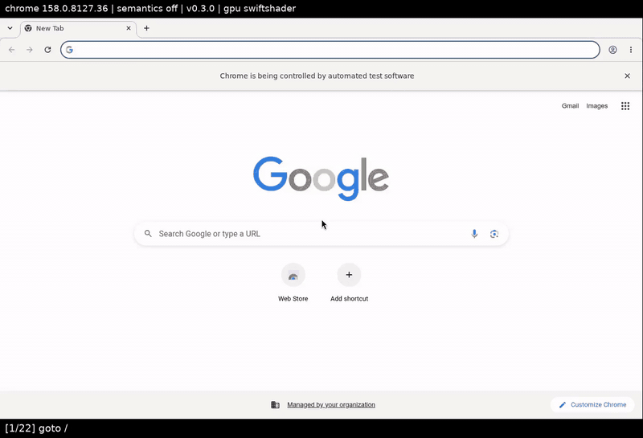

# The bottom of the page is unreachable under an `AppBar`

When `BrowserScroller` is the body of a `Scaffold` with an `AppBar`, the page stops scrolling 56px before the end of the content. The last 56px (the height of the `AppBar`) can never be seen.



[proof.mp4](proof.mp4)

## Steps

1. Run the app:
   ```
   cd app
   flutter run -d chrome --release
   ```
2. Scroll all the way down (wheel, scrollbar, or the `End` key several times).

Expected: the last row, `Item 59 (bottom)`, is visible.

Actual: the page stops with `Item 58` at the bottom of the window. In my run the window was 656px tall and the browser stopped at `window.scrollY` 2344. The content needs 2400.

## Cause

The placeholder height is computed as the scroll offset plus [the scroller's own viewport height](https://github.com/flutter-zl/flutter-browser-scroll/blob/7193d2085cbb836bec3a3bf5e371e2250a9d5136/lib/src/browser_scroller.dart#L188-L193). The browser scrolls that placeholder in a window that is `window.innerHeight` tall. With an `AppBar`, the scroller's viewport is 56px shorter than the window, so the browser runs out of document 56px before Flutter reaches `maxScrollExtent`.

Anything else that makes the scroller shorter than the window should add to the gap, for example a bottom navigation bar. I didn't measure that case.

## Possible fix

Size the placeholder with the height of the window (or of the Flutter view) instead of `position.viewportDimension`.
