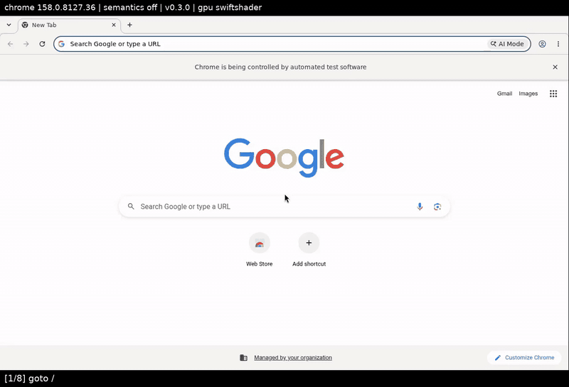

# The `End` key and the scrollbar stop short of the bottom

On a long page, pressing `End` scrolls one screen instead of going to the bottom. The scrollbar has the same problem: its thumb is sized for a page that is two screens long, and dragging it to the end only moves one screen. The page grows by one screen each time the user reaches the current end.

All the content is still reachable, it just takes several tries.



[proof.mp4](proof.mp4)

## Steps

1. Run the app:
   ```
   cd app
   flutter run -d chrome --release
   ```
2. Press `End` once.

Expected: the page scrolls to the last row, `Item 59 (bottom)`.

Actual: the page scrolls by one screen. In my run the window was 656px tall and `End` stopped at `window.scrollY` 656. The bottom is at 2344.

## Cause

`PlaceholderHeightTracker` only exposes [one viewport of lookahead](https://github.com/flutter-zl/flutter-browser-scroll/blob/7193d2085cbb836bec3a3bf5e371e2250a9d5136/lib/src/placeholder_height.dart#L44-L47) past the furthest offset the user has reached. Its doc comment says this is for lazy lists whose `maxScrollExtent` is inaccurate. But `BrowserScroller` puts its child in a [`SliverToBoxAdapter`](https://github.com/flutter-zl/flutter-browser-scroll/blob/7193d2085cbb836bec3a3bf5e371e2250a9d5136/lib/src/browser_scroller.dart#L443-L450), which lays out the whole child, so `maxScrollExtent` is exact after the first layout.

## Possible fix

Size the placeholder from `maxScrollExtent` directly, with no lookahead cap.
