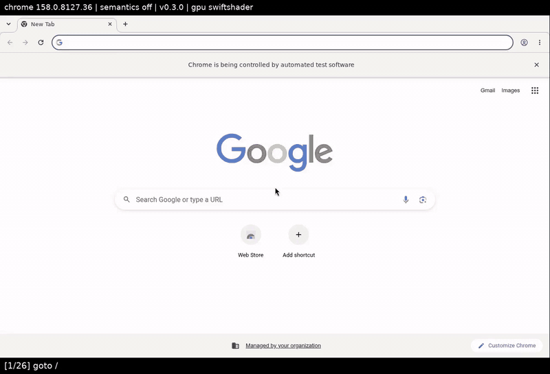

# The scroll made by `Tab` focus traversal snaps back

Pressing `Tab` to move focus to a widget below the fold scrolls the Flutter content, but the browser doesn't follow. The scrollbar stays at the top, and the next mouse wheel movement throws the page back to where the browser thinks it is. The focused widget ends up off-screen.



[proof.mp4](proof.mp4)

## Steps

1. Run the app:
   ```
   cd app
   flutter run -d chrome --release
   ```
2. Click `Button 0`.
3. Press `Tab` 14 times. Focus moves down to `Button 14` and the content scrolls to keep it visible. The label in the top right corner shows the offset of the Flutter scroll position.
4. Scroll down one notch with the mouse wheel.

Expected: the wheel continues from where `Tab` left the page.

Actual: the page jumps back to the top. In my run, after step 3 the Flutter offset was 520 while `window.scrollY` was still 0. After step 4 both were 40.

## Cause

Focus traversal calls [`Scrollable.ensureVisible`](https://github.com/flutter/flutter/blob/4d19bda07ae859c5d3a205e3a61619ff485a1182/packages/flutter/lib/src/widgets/focus_traversal.dart#L213-L219), which moves the `ScrollPosition` directly. `BrowserScrollController` sends [`animateTo` and `jumpTo`](https://github.com/flutter-zl/flutter-browser-scroll/blob/7193d2085cbb836bec3a3bf5e371e2250a9d5136/lib/src/browser_scroll_controller.dart#L88-L114) to the browser, but only when they are called on the controller. So the position moves and the browser doesn't. On the next browser scroll event, [`_updateScrollPosition`](https://github.com/flutter-zl/flutter-browser-scroll/blob/7193d2085cbb836bec3a3bf5e371e2250a9d5136/lib/src/browser_scroller.dart#L155-L176) overwrites the position with `window.scrollY`.

## Possible fix

Override `createScrollPosition` in `BrowserScrollController` and return a `ScrollPosition` that sends every offset change through the browser. [07](../07-caret-stays-offscreen) and [10](../10-selection-drag-no-autoscroll) need the same thing.
