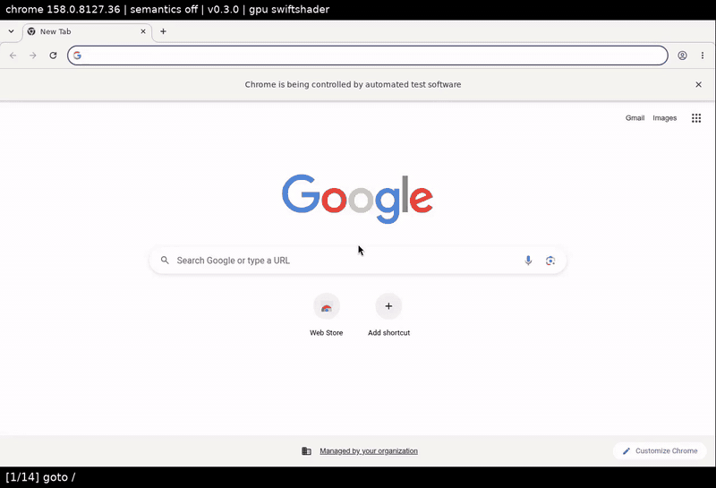

# Typing in a text field that is off-screen doesn't bring it back

When a focused text field is scrolled out of view and the user types, Flutter normally scrolls the field back into view. With `BrowserScroller` the text goes into the field but the page doesn't move, so the user types without seeing it.



[proof.mp4](proof.mp4)

## Steps

1. Run the app:
   ```
   cd app
   flutter run -d chrome --release
   ```
2. Click the `Top Input` text field.
3. Scroll down with the mouse wheel until the field is out of view.
4. Type `hello caret`.

Expected: the page scrolls back up to show the field.

Actual: the page doesn't move. In my run `window.scrollY` stayed at 900, and the field's value was `hello caret`.

## Cause

`EditableText` reveals the caret with `showOnScreen`, and the viewport [skips that scroll](https://github.com/flutter/flutter/blob/4d19bda07ae859c5d3a205e3a61619ff485a1182/packages/flutter/lib/src/rendering/viewport.dart#L1435-L1442) when its position doesn't allow implicit scrolling. `BrowserScroller` uses [`NeverScrollableScrollPhysics`](https://github.com/flutter-zl/flutter-browser-scroll/blob/7193d2085cbb836bec3a3bf5e371e2250a9d5136/lib/src/browser_scroller.dart#L433-L435), whose [`allowImplicitScrolling`](https://github.com/flutter/flutter/blob/4d19bda07ae859c5d3a205e3a61619ff485a1182/packages/flutter/lib/src/widgets/scroll_physics.dart#L1112-L1113) is `false`.

## Possible fix

Use physics that allow implicit scrolling and still refuse user offsets. The reveal then moves the `ScrollPosition` directly, so it also needs the custom `ScrollPosition` from [06](../06-tab-focus-snaps-back) to reach the browser.
