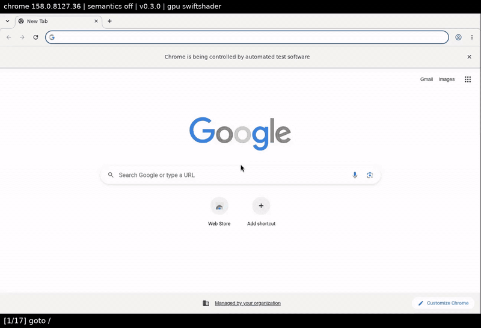

# An embedded Flutter view swallows clicks on the rest of the page

When the Flutter view is embedded in a host HTML page (`hostElement`), the HTML around the view can't be clicked. Clicks on a button above the view never reach it.

The package README doesn't mention embedding, so this may not be supported yet. I'm listing it because `JsViewScroller` has a code path for a host that isn't `<body>`.

The rest of this setup works: the Flutter content is drawn where the host element is, the host page scrolls, and the content follows.



[proof.mp4](proof.mp4)

## Steps

1. Run the app:
   ```
   cd app
   flutter run -d chrome --release
   ```
2. Click `HTML header button (0)`, the HTML button above the Flutter view.

Expected: the button's label changes to `HTML clicked: 1`.

Actual: nothing happens. In my run `document.elementFromPoint()` at the button returned `<flutter-view>`.

## Cause

In this mode `setup()` leaves a clone of the host element in the page as a placeholder and [pins the real host over the whole window](https://github.com/flutter-zl/flutter-browser-scroll/blob/7193d2085cbb836bec3a3bf5e371e2250a9d5136/lib/src/js_view_scroller.dart#L72-L80). `BrowserScroller` only paints inside the visible part of the placeholder, but the host element still covers the window and receives every pointer event.

Two smaller things in the same code:

- The clone keeps the host's `id`, so the page ends up with two `#flutter-host` elements.
- The clone loses its `style` attribute. A host that is sized with an inline style gets a 0px tall placeholder, and nothing is drawn. That's why this app sizes the host with a CSS rule.

## Possible fix

Pin the host over the visible part of the placeholder instead of the whole window, and update it as the page scrolls.
