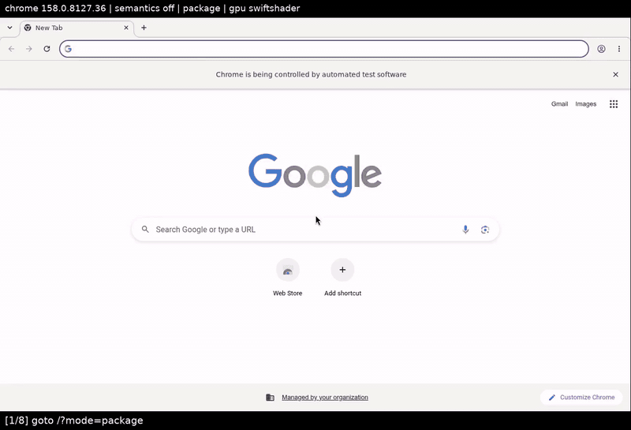
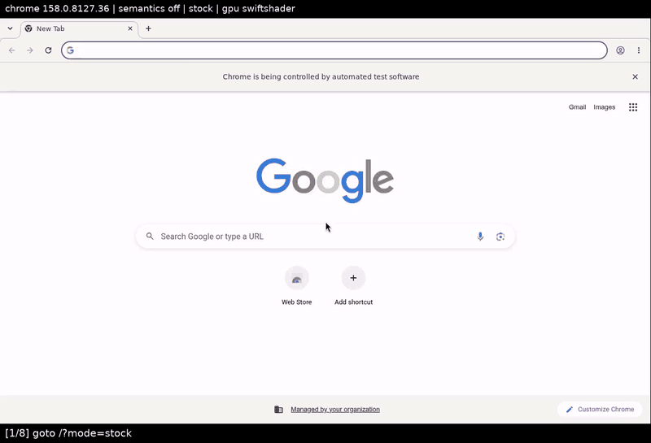

# Dragging a text selection past the edge doesn't scroll the page

With a `SelectionArea` around the page, dragging a selection below the bottom edge of the scroller should scroll the page so the selection can keep growing. With `BrowserScroller` the page doesn't move.

The app has a control: the same widget tree with `SingleChildScrollView` in place of `BrowserScroller`.

With `BrowserScroller`:



[proof-package.mp4](proof-package.mp4)

With `SingleChildScrollView`:



[proof-stock.mp4](proof-stock.mp4)

## Steps

1. Run the app:
   ```
   cd app
   flutter run -d web-server --web-port 8080 --release
   ```
2. Open `http://localhost:8080/?mode=package` in Chrome.
3. Press the mouse button on the text of `Selectable line 1`, drag down into the dark bar at the bottom, and hold it there.

Expected: the list scrolls and the selection grows. The dark bar shows the scroll offset going up.

Actual: the selection stops at the last visible line and the offset stays at 0.

With `http://localhost:8080/?mode=stock` the same drag scrolls the list. In my run it reached an offset of 674 before the mouse button was released.

## Cause

Selection autoscroll [doesn't start](https://github.com/flutter/flutter/blob/4d19bda07ae859c5d3a205e3a61619ff485a1182/packages/flutter/lib/src/widgets/scrollable_helpers.dart#L216-L221) when the scrollable's physics refuse user offsets, and `BrowserScroller` uses [`NeverScrollableScrollPhysics`](https://github.com/flutter-zl/flutter-browser-scroll/blob/7193d2085cbb836bec3a3bf5e371e2250a9d5136/lib/src/browser_scroller.dart#L433-L435).

## Possible fix

Allowing the autoscroll isn't enough by itself. It moves the `ScrollPosition` directly, so it would hit the same problem as [06](../06-tab-focus-snaps-back) and needs the same custom `ScrollPosition`.
