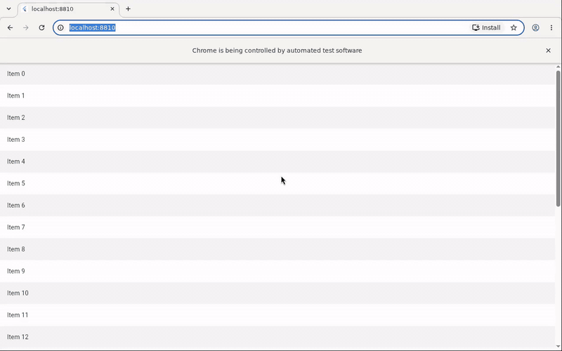

# Reloading the page loses the scroll position

Reloading a scrolled page brings it back at the top. Browsers restore the scroll position of a regular page on reload and on back/forward navigation, so I'd expect a page that scrolls natively to keep it too.

A plain Flutter Web app doesn't restore its scroll offset on reload either, so this isn't a regression. It's a gap between the package and a real browser-scrolled page.



[proof.mp4](proof.mp4)

## Steps

1. Run the app:
   ```
   cd app
   flutter run -d chrome --release
   ```
2. Scroll down until `Item 32` is at the top of the window.
3. Reload the page.

Expected: the page comes back with `Item 32` at the top.

Actual: the page comes back at `Item 0`. In my run `window.scrollY` went from 1600 to 0.

Going back to the app from another page does the same thing when Chrome can't use its back/forward cache (I tested that by serving the app with `Cache-Control: no-store`). When the back/forward cache is used, the position is kept.

## Cause

As far as I can tell, the browser restores the scroll position while the document is still one screen tall, so it clamps the position to 0. The placeholder [starts at `100vh`](https://github.com/flutter-zl/flutter-browser-scroll/blob/7193d2085cbb836bec3a3bf5e371e2250a9d5136/lib/src/js_view_scroller.dart#L91-L98) and only gets its real height in a [post-frame callback](https://github.com/flutter-zl/flutter-browser-scroll/blob/7193d2085cbb836bec3a3bf5e371e2250a9d5136/lib/src/browser_scroller.dart#L131-L134) after Flutter's first frame.

## Possible fix

Set `history.scrollRestoration = 'manual'`, save the offset (for example in `sessionStorage`), and scroll to it once the placeholder has its real height.
